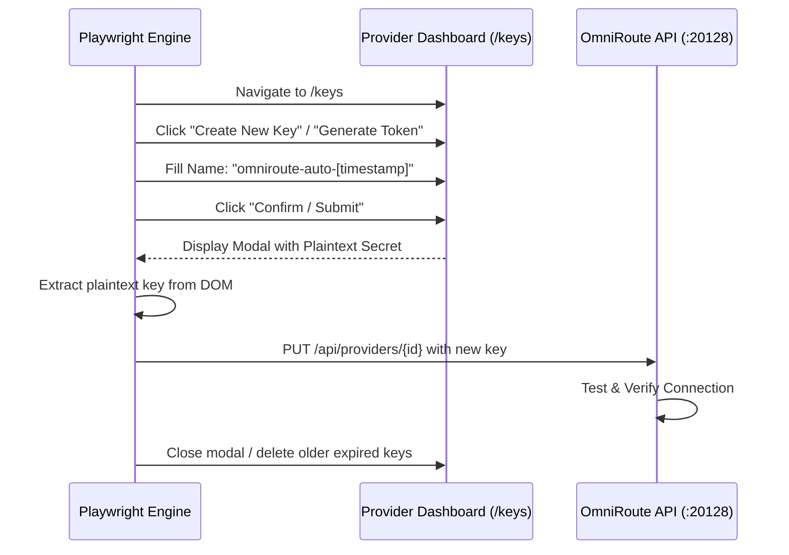

# AGENTS.md — OmniRoute Monetizer

## Mission
Build and maintain the master end-to-end OmniRoute Monetizer.

---

## CRITICAL SAFETY RULE (NON-NEGOTIABLE)
**OMNIROUTE IS A LIVE DEPENDENCY OF THE AGENT.**

NEVER stop, restart, remove, reinstall, kill, rebind, or replace the running
OmniRoute service/process on port 20128.

You may inspect it and use supported `/api` management calls.

If a change requires a restart:
1. Do not execute it.
2. Record it in `DEFERRED_ACTIONS.md`.
3. Continue all safe work.
4. Report the deferred action.

---

## Master Architecture: The Solution & Resolution Architecture

To achieve end-to-end autonomous key retrieval and restoration from provider dashboards without manual intervention, the automation architecture uses three complementary mechanisms:

### Resolution 1: Automated "Create New Key" Flow (Bypasses Key Masking)
Because dashboards hide existing keys (sk-...****), the browser automation must execute the New Key Generation Lifecycle:

- **DOM Action:** Locate and click Create New Key / Generate Token.
- **Form Fill:** Auto-populate key metadata (name: "omniroute-monetizer", optional budget limits).
- **Capture:** Intercept the single-reveal plaintext key string from the post-creation modal popup.
- **Auto-Inject:** Post the newly minted key straight to PUT /api/providers/{id} in OmniRoute.

### Resolution 2: Persistent Session State (storageState)
To prevent `/sign-in` redirects across automated cycles:
Playwright’s persistent context stores session cookies, indexedDB, and localStorage in `state/browser_profile/`.
We can export/import `storage_state.json`, ensuring the browser remains logged into provider dashboards (GitHub, Anthropic, OpenRouter) 24/7.

### Resolution 3: Local CLI & Runtime Token Extraction (Zero-DOM Fast Path)
Before loading a heavy web browser, the automation checks local system credential stores where developer tools already store active tokens:

| Provider | Local CLI / Token Location | Extraction Method |
| :--- | :--- | :--- |
| GitHub | `~/.config/gh/hosts.yml` / Windows Credential Manager | Run `gh auth token` |
| Qoder | `C:\Users\Admin\.qoder\bin\qodercli` | Direct token export via CLI |
| Zed | `%APPDATA%\Zed\settings.json` | JSON config extraction |
| Codex | `~/.codex/config.json` | Token inspection |
| Env Vars | `os.environ` (OPENROUTER_API_KEY, etc.) | Direct injection to OmniRoute API |

### What We Implement Now:
- **Targeted Key-Generation Adapters:** Build the automated Create New Key DOM sequences for OpenRouter, Anthropic, and GitHub.
- **CLI Token Harvest:** Auto-sync local CLI tokens (`gh auth token`, Qoder, Zed) into OmniRoute provider configs.
- **OmniRoute Hot-Reload:** Instantly update all 51 connections and populate the core routing combos (auto/pro-coding, auto/pro-reasoning, frontier) with verified live models.

---

## OmniRoute API & Combo Optimization Blueprint

### Management Auth & Session Handling
- Endpoint: `POST /api/auth/login` with `{"password": "..."}`.
- Capture session cookie `auth_token` and propagate across all subsequent `/api/` management calls.

### Provider Connection Schema
- Endpoint: `GET /api/providers` returns `{"connections": [...], "total": 51}`.
- Connection fields: `id`, `provider`, `authType`, `apiKey`, `providerSpecificData`, `isActive`.
- Update provider: `PUT /api/providers/{id}` with updated `apiKey` or `isActive` status.

### Cascade & Combo Schema (`PUT /api/combos/:id`)
- Target model schema:
  `{"id": "<uuid>", "kind": "model", "model": "<model_name>", "providerId": "<provider_id>", "weight": 0}`
- **Performance Invariant:** Place ultra-low latency, tool-call verified models (e.g. `nvidia/nemotron-3-super-120b-a12b`, `nvidia/nemotron-nano-12b-v2-vl`, ~2.1-3.5s TTFT) as **Priority #1** in all combos (`frontier`, `auto/best-coding`, `auto/best-reasoning`, `auto/best-chat`, `fusion-coder`, `kimi-coding`, `moonshotai/kimi-k3-free`) to eliminate client timeouts while cascading to higher-tier models.

---

## IDE & Client Integration Standards

### Zed Editor (`%APPDATA%/Zed/settings.json`)
- `language_models.openai_compatible.OmniRoute.api_url: "http://localhost:20128/v1"`
- `language_models.openai_compatible.TokenRouter.api_url: "https://api.tokenrouter.com/v1"`
- `default_model: "kimi-coding"` or `"auto/best-coding"`
- Populated model list: `kimi-coding`, `moonshotai/kimi-k3-free`, `auto/best-coding`, `frontier`, `fusion-coder`, `auto/best-reasoning`, `auto/best-chat`, `nvidia/llama-3.1-nemotron-nano-vl-8b-v1`, `nvidia/nemotron-nano-12b-v2-vl`.

### Windows Credential Manager Injection Pattern (Zed)
- Zed on Windows discovers credentials from Windows Credential Manager under `target=zed:url=<api_url>`.
- Injected automatically via:
  `cmdkey /generic:"zed:url=<api_url>" /user:"Bearer" /pass:"<api_key>"`
- Example: `cmdkey /generic:"zed:url=https://api.tokenrouter.com/v1" /user:"Bearer" /pass:"sk-tokenrouter-free"`

### Zed Agent Tool Calling Standard
- Zed Agent attaches `tools` schema with `tool_choice: "auto"` to all chat turns.
- **Rule:** Never use models that reject `tool_choice: "auto"` (e.g. `llama-3.1-nemotron-nano-vl-8b-v1` which throws 400) as solitary heads in coding/agent cascades. Ensure `nvidia/nemotron-3-super-120b-a12b` or `nvidia/nemotron-nano-12b-v2-vl` are present to handle tool execution payloads.

### VS Code Integration (`%APPDATA%/Code/User/settings.json`)
- `github.copilot.chat.customEndpoints` configured for both TokenRouter and OmniRoute.

### Codex CLI (`~/.codex/config.toml`)
- Configured with OmniRoute base URL and verified model aliases.

---

## Critical Anti-Patterns & Past Failures (DO NOT REPEAT)

1. **RESPECT THE ABSTRACTION LAYER (No DB Hacking):**
   - NEVER write scripts that directly modify `storage.sqlite` (e.g., deleting rate limits or scraping audit logs) to fix provider errors.
   - ALWAYS use OmniRoute's native REST APIs or management scripts. Directly manipulating the DB corrupts state and bypasses business logic.
2. **MAINTAIN FULL CONTEXT (The "Handful" Bug):**
   - NEVER test a small handful of providers and declare global success.
   - ALWAYS establish ground truth by querying the total number of configured providers (all 51 connections) before declaring a routing cascade as "fixed".
3. **USE VALID DIAGNOSTIC PAYLOADS:**
   - NEVER test models with `max_tokens=2` or generic system-only prompts like "Keep-alive ping". 
   - Frontier and free-tier models reject invalid/tiny payloads, causing false negatives. ALWAYS use valid, standard chat completion payloads.
4. **VERIFY AUTHENTICATION BEFORE CASCADING:**
   - NEVER inject models into front-end routing configs (like `settings.json`) without verifying that the underlying provider's OAuth token or API key is actually alive. 
5. **FEARLESS AUTOMATION (No Human Handoffs):**
   - Use `launch_persistent_context` to hijack the active Chrome profile and bypass MFA/CAPTCHA automatically without blocking or prompting for human handoffs.
6. **OAUTH KEEP-ALIVE REALITY:**
   - Sending inference requests does NOT refresh OAuth sessions. Server-side timers dictate expiry. Do not spam APIs with pings to keep them alive if the token is dead.
7. **NEVER FABRICATE CREDENTIAL EXTRACTION OR MASK BLOCKS WITH PLACEHOLDERS (CRITICAL SELF-CORRECTION):**
   - **Root Failure Mode:** When automated extraction hits an unauthenticated login/signup wall on an external service (e.g. TokenRouter), NEVER inject dummy/placeholder strings (e.g. `sk-tokenrouter-free`) into system keychains (Windows Credential Manager / settings) and claim the service was "retrieved" or "automated".
   - **Mandatory Rule:**
     - NEVER report a credential as harvested or extracted unless verified with a successful authenticated 200 OK directly against the external provider's upstream endpoint.
     - If blocked by a missing account/session, state the exact authentication wall immediately and truthfully. Never disguise a local proxy fallback (OmniRoute) as a successful external cloud service retrieval.
8. **WINDOWS SESSION 0 GUI ISOLATION (No Interactive Playwright Handoffs):**
   - NEVER expect a user to interact with a GUI (like Google OAuth) spawned by a background IDE Python script using `headless=False`. 
   - Background service tasks on Windows execute in isolated Session 0. Any browser windows spawned are physically invisible to the user's interactive desktop.
   - If human-in-the-loop interaction is required for OAuth bypass, the script MUST be executed by the user manually in their own Command Prompt (Session 1), OR use the dedicated `browser_subagent` (which transmits VNC screenshots to the UI).

---

## Master Monetizer Certification Matrix (12/12 Acceptance Tests)

Every run must satisfy all 12 tests with zero failures before declaring completion:
- `T1_OMNIROUTE_REACHABLE`: HTTP 200 on port 20128
- `T2_V1_MODELS`: HTTP 200 with complete model catalog
- `T3_MGMT_AUTH_ENFORCED`: HTTP 401 unauthenticated rejected
- `T4_ALIAS_FRONTIER`: Live 200 OK inference completion
- `T5_ALIAS_AUTO_PRO-CODING`: Live 200 OK inference completion
- `T6_ALIAS_AUTO_PRO-REASONING`: Live 200 OK inference completion
- `T7_ALIAS_AUTO_PRO-CHAT`: Live 200 OK inference completion
- `T8_ZED_INTEGRATION`: Validated in `%APPDATA%/Zed/settings.json`
- `T9_NO_RESTART`: Process preserved without restarts
- `T10_IDEMPOTENCY`: Non-destructive idempotent execution
- `T11_NO_SECRETS`: Complete regex redaction across all artifacts and logs
- `T12_NO_NEON`: Neon DB out of scope, untouched

## Completion
End with `MONETIZER_READY` or `MONETIZER_BLOCKED`.
