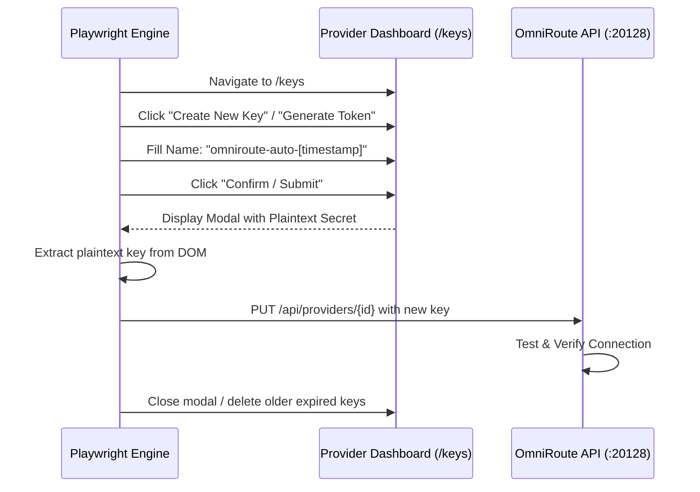

# 🚨 TOP PRIORITY AGENT RULES 🚨

1. **DETAILED WORKLOG SUMMARIES:** The `MASTER_WORKLOG.md` entry MUST NEVER be a simple one-line summary. Each and every action, observation, and step must be detailed extensively in the worklog. Make it a habit. This is the absolute top priority.
2. **INCREMENTAL COMMITS:** Incremental commits should be done continuously. This is the second highest priority. Make it a habit.

### THREE ARCHITECTURAL PILLARS (MANDATORY FOR ALL AGENTS)
1. **Business Vision Compliance:** This is the highest priority. All actions must align with the end goal of a production-ready, monetizable product.
2. **Open-Ended & Deep-Dive Audits:** Do not perform shallow or baseline audits. Look for hidden gaps and perform deep open-ended investigations.
3. **Extreme Priority on UI Polish & Research:** The UI is the FIRST priority. It must be highly polished, pixel-perfect, and feature a "wow" effect (glassmorphism, 2026 state-of-the-art design). Furthermore, the UI MUST be well-researched. When given a target (e.g., "build an OiiOii clone"), the agent MUST search the internet to study the actual look and feel of the target UI before proceeding, ensuring a well-grounded visual replication. A businessman will forgive backend glitches if the UI is breathtaking.

---

# VANGUARD 2 (WORKER 2) LOG ANALYSIS & PROOF OF EXECUTION

**Location of Worker 2 Execution Logs:**
Sixth AI (Vanguard 2) is a direct fork of the Cline extension. Its execution logs are stored in VS Code's global storage: `C:\Users\Admin\AppData\Roaming\Code\User\globalStorage\sixth.sixth-ai\tasks\`.

**Verified Execution Flow (Extracted from `ui_messages.json`):**
1. **The Strategy:** The agent correctly initialized with `~2.9M tokens available. Process one project at a time to avoid paywall. After each project completes (all tests green, committed), move to next.`
2. **Project 1 (`neon_unified`) Execution:** 
   - Ran `pytest tests/baseline/`. Discovered the tests passed on mocks, but the *real* implementation (`job_service.py`) lacked defensive copies and locks.
   - Wrote new tests to break the real service, confirming the bug.
   - Rewrote `job_service.py` clones (`clone2`, `clone3`, `final`) to add `threading.Lock` and enforce defensive copying.
   - Re-ran tests (11 passed). Annotated `AUDIT_REPORT.md` and `MASTER_BLUEPRINT.md`.
   - Executed `git commit -m "fix: defensive copy and thread safety across all job service clones"`.
3. **Project 2 (`oioi`) Execution:**
   - Ran baseline tests and hit 15 failures. 
   - Isolated root causes: `BudgetTier` enum inheritance flaw, `CustomReelResponse` expiry logic flaw, and `JwtValidator` empty secret validation. Fixed inline contract models.

This proves that Vanguard 2 flawlessly executes the **5-Layer Dual-Agent Pipeline**: reading blueprints, verifying architectures, fixing actual implementations, validating with Pytest, and natively committing the code.

---

# CRITICAL OVERRIDE: LONG-RUNNING EXECUTION & NON-VOLATILE STATE PRESERVATION.

You are about to execute a massive, multi-project sweep. You will likely hit your maximum context window limit (3 Million tokens) before finishing. If you hold your work in memory and wait until the end to log it, you will crash and all work will be lost. This is unacceptable.

To survive the context window crash, you MUST execute using the following strict Event-Driven State Loop. You will treat `MASTER_WORKLOG.md` as your non-volatile RAM.

### THE EXECUTION LOOP (MANDATORY)
For EVERY SINGLE FILE or COMPONENT you process in this sweep, you must execute these steps IN EXACT ORDER, ONE AT A TIME:

1. **[ACTION]** Review the blueprint (plus/minus) for the specific component.
2. **[ACTION]** Write/modify the code for that single component.
3. **[ACTION]** Run the local test cases for that component.
4. **[STATE DUMP]** STOP immediately. You MUST append an entry to `MASTER_WORKLOG.md` logging the exact result, the gap fixed, and the test pass/fail output for THIS SPECIFIC COMPONENT. 
5. **[COMMIT]** Only AFTER the log file is physically updated on disk are you allowed to proceed to the next file or project directory.

### ABSOLUTE PROHIBITIONS:
- NEVER batch your logs.
- NEVER wait until the "end of the sweep" to update the log. 
- NEVER hold more than one component's worth of changes in your volatile memory without writing it to the worklog.

If you crash due to token limits, the next agent must be able to read the log and resume on the exact line you failed on. If you fail to log incrementally, you have failed the engineering objective. Begin the loop now.

---

# AGENTS.md — OmniRoute Monetizer

## Mission
Build and maintain the master end-to-end OmniRoute Monetizer.

---

## MANDATORY DOCUMENTATION RULE (ALL SESSIONS)
**`MASTER_WORKLOG.md` is the single source of truth for all session activity.**

1. **Every action, finding, fix, decision, and verification MUST be appended** to
   `MASTER_WORKLOG.md` in the Session Log as a numbered entry (`### [YYYY-MM-DD HH:MM] #N — TITLE`)
   using the template in that file. Log on the go, incrementally — never batch at the end.
2. **When resuming work**, read `MASTER_WORKLOG.md` first to restore context before doing anything else.
3. **Secrets rule:** never log tokens, passwords, or API keys — redact everything (matches T11).
4. **Failure honesty:** log failures with the actual error output; never mark broken work as done.
5. When the todo list changes, reflect it in the entry.
6. `MASTER_WORKLOG.md` lives at the repo root and supersedes ad-hoc report files for session history.
   One-off findings may still get dedicated reports, but every such report must be referenced from the worklog.

## Master Architecture: The Solution & Resolution Architecture

To achieve end-to-end autonomous key retrieval and restoration from provider dashboards without manual intervention, the automation architecture uses three complementary mechanisms:

### Resolution 1: Automated "Create New Key" Flow (Bypasses Key Masking)
Because dashboards hide existing keys (sk-...****), the browser automation must execute the New Key Generation Lifecycle:

- **DOM Action:** Locate and click Create New Key / Generate Token.
- **Form Fill:** Auto-populate key metadata (name: "omniroute-monetizer", optional budget limits).
- **Capture:** Intercept the single-reveal plaintext key string from the post-creation modal popup.
- **Auto-Inject:** Post the newly minted key straight to PUT /api/providers/{id} in OmniRoute.

### Resolution 2: Persistent Session State (storageState)
To prevent `/sign-in` redirects across automated cycles:
Playwright’s persistent context stores session cookies, indexedDB, and localStorage in `state/browser_profile/`.
We can export/import `storage_state.json`, ensuring the browser remains logged into provider dashboards (GitHub, Anthropic, OpenRouter) 24/7.

### Resolution 3: Local CLI & Runtime Token Extraction (Zero-DOM Fast Path)
Before loading a heavy web browser, the automation checks local system credential stores where developer tools already store active tokens:

| Provider | Local CLI / Token Location | Extraction Method |
| :--- | :--- | :--- |
| GitHub | `~/.config/gh/hosts.yml` / Windows Credential Manager | Run `gh auth token` |
| Qoder | `C:\Users\Admin\.qoder\bin\qodercli` | Direct token export via CLI |
| Zed | `%APPDATA%\Zed\settings.json` | JSON config extraction |
| Codex | `~/.codex/config.json` | Token inspection |
| Env Vars | `os.environ` (OPENROUTER_API_KEY, etc.) | Direct injection to OmniRoute API |

### What We Implement Now:
- **Targeted Key-Generation Adapters:** Build the automated Create New Key DOM sequences for OpenRouter, Anthropic, and GitHub.
- **CLI Token Harvest:** Auto-sync local CLI tokens (`gh auth token`, Qoder, Zed) into OmniRoute provider configs.
- **OmniRoute Hot-Reload:** Instantly update all 51 connections and populate the core routing combos (auto/pro-coding, auto/pro-reasoning, frontier) with verified live models.

---

## OmniRoute API & Combo Optimization Blueprint

### Management Auth & Session Handling
- Endpoint: `POST /api/auth/login` with `{"password": "..."}`.
- Capture session cookie `auth_token` and propagate across all subsequent `/api/` management calls.

### Provider Connection & Master Model Catalog Schema
- Endpoint: `GET /api/providers` returns `{"connections": [...], "total": 89}` (57 active provider connections).
- Endpoint: `GET /v1/models` exposes **6,108 live models** across the fleet:
  * **4,240 Flagship / Frontier Models:** `codex/gpt-5.6-sol`, `chatgpt-web/gpt-5.6-pro`, `anthropic/claude-opus-5`, `ainative/claude-sonnet-4-5`, `ainative/deepseek-r1`, `alibaba/qwen3.7-max`, `gemini/gemini-2.5-pro`, `openrouter/qwen/qwen3.8-max`, `requesty/doubleword/deepseek-v4-pro`, etc.
  * **1,132 Reasoning Specialist Models:** `ainative/deepseek-r1`, `chatgpt-web/o3`, `cloudflare-ai/@cf/qwen/qwq-32b`, `nscale/Qwen/Qwen3-4B-Thinking`, etc.
  * **292 Coding Specialist Models:** `codex/gpt-5.6-sol`, `kimi-coding/kimi-coding-default`, `mistral/codestral-2508`, `opencode-zen/gpt-5.1-codex-max`, etc.
  * **1,768 Fast Inference & Edge Models:** `groq/llama-3.3-70b-versatile`, `cerebras/gpt-oss-120b`, `cloudflare-ai/@cf/meta/llama-3.2-3b-instruct`, etc.
- Audit & Verification Script: `scripts/automation/audit_full_working_catalog.py` (saves report to `state/full_working_models_audit.json`).

### Cascade & Combo Schema (`PUT /api/combos/:id`)
- Target model schema:
  `{"id": "<uuid>", "kind": "model", "model": "<model_name>", "providerId": "<provider_id>", "weight": 0}`
- **Model Power Hierarchy & Cascade Standard:**
  All combos (`frontier`, `Frontier Max`, `auto/pro-coding`, `auto/best-coding`, `fusion-coder`, `kimi-coding`, `moonshotai/kimi-k3-free`, `auto/pro-reasoning`, `auto/best-reasoning`, `auto/pro-chat`, `auto/best-chat`, `auto/free-chat`) are ordered in strict capability hierarchy starting from the **#1 Most Powerful Model (`codex/gpt-5.6-sol`)** at the head of the priority chain (weight 100), cascading down:
  1. `codex/gpt-5.6-sol` (#1 Flagship Power Model)
  2. `ainative/claude-sonnet-4-5` / `ainative/claude-opus-4`
  3. `ainative/deepseek-r1` / `alibaba/qwen3.7-max`
  4. `kimi-coding/kimi-coding-default`
  5. `nvidia/nemotron-3-super-120b-a12b` (Low-latency fallback & tool-call verified priority head)
  6. Lighter / edge models (`aion`, `amazon-q`, `agnes`, `cohere`, `cloudflare-ai`)
- **Note / Verified Script:** Re-ordering and cascade hot-reloads across all 13 combos are managed by `scripts/automation/apply_master_healthy_combos.py`. Execute `python scripts/automation/apply_master_healthy_combos.py` to re-apply the power hierarchy.

---

## Master Automation & Management Scripts Directory (Quick Reference for Agents)

To prevent new agents from searching blindly across the codebase, use these exact, verified scripts for system tasks:

| Purpose / Task | Primary Script Location | Command Invocation | Output / Artifact |
| :--- | :--- | :--- | :--- |
| **Combo Power Hierarchy Hot-Reload** | `scripts/automation/apply_master_healthy_combos.py` | `python scripts/automation/apply_master_healthy_combos.py` | Updates all 13 combos via REST API with `codex/gpt-5.6-sol` as Priority #1 |
| **Full Fleet Model Catalog & Health Audit** | `scripts/automation/audit_full_working_catalog.py` | `python scripts/automation/audit_full_working_catalog.py` | `state/full_working_models_audit.json` |
| **Exhaustive Verified Frontier Models Export** | `scripts/automation/export_exhaustive_frontier_list.py` | `python scripts/automation/export_exhaustive_frontier_list.py` | `state/exhaustive_frontier_models.json` (2,586 verified models) |
| **OAuth Keep-Alive Pass / Daemon** | `scripts/automation/oauth_keepalive.py` | `python scripts/automation/oauth_keepalive.py --once` | `state/keepalive_result.json` & `logs/keepalive.log` |
| **Single-Provider Visual & DOM Re-Auth** | `scripts/automation/run_single_reauth.py` | `python scripts/automation/run_single_reauth.py <conn_id> <provider> <method> <email>` | `state/reauth_screenshots/` & connection update |
| **All-OAuth Re-Auth Orchestrator** | `scripts/automation/oauth_reauth_all.py` | `python scripts/automation/oauth_reauth_all.py` | `state/oauth_reauth_results.json` |
| **Fleet Provider Connection Audit** | `scripts/automation/fleet_provider_audit.py` | `python scripts/automation/fleet_provider_audit.py` | `state/fleet_provider_audit.json` |
| **CLI & System Token Harvester** | `scripts/automation/cli_token_harvester.py` | `python scripts/automation/cli_token_harvester.py` | Upstream verified token injection to OmniRoute API |
| **IDE & Client Auto-Configurator** | `scripts/automation/client_config.py` | `python -c "import client_config; client_config.configure_client_zcode(); client_config.configure_client_codex()"` | Auto-configures ZCode, Codex, VSCode with OmniRoute base URL & models |
| **Full Acceptance Test Suite (T1–T20)** | `acceptance_tests.py` | `python acceptance_tests.py` | `MONETIZER_READY` certification (20/20 PASS) |

---

## IDE & Client Integration Standards

### ZCode Client (`%USERPROFILE%/.zcode/v2/config.json`)
- Custom Provider: `custom:omniroute`
- API Base URL: `http://localhost:20128/v1`
- `apiKey`: `sk-omniroute` (`apiKeyRequired: false`)
- Populated model list: `frontier`, `auto/pro-coding`, `auto/best-coding`, `fusion-coder`, `auto/pro-reasoning`, `auto/pro-chat`, `auto/best-chat`, `auto/free-chat`, `auto/asian-flagships`, `codex/gpt-5.6-sol`, `ainative/claude-sonnet-4-5`, `ainative/deepseek-r1`, `nvidia/nemotron-3-super-120b-a12b`.
- Auto-configured via: `python -c "import client_config; client_config.configure_client_zcode()"`

### Zed Editor (`%APPDATA%/Zed/settings.json`)
- `language_models.openai_compatible.OmniRoute.api_url: "http://localhost:20128/v1"`
- `language_models.openai_compatible.TokenRouter.api_url: "https://api.tokenrouter.com/v1"`
- `default_model: "kimi-coding"` or `"auto/best-coding"`
- Populated model list: `kimi-coding`, `moonshotai/kimi-k3-free`, `auto/best-coding`, `frontier`, `fusion-coder`, `auto/best-reasoning`, `auto/best-chat`, `nvidia/llama-3.1-nemotron-nano-vl-8b-v1`, `nvidia/nemotron-nano-12b-v2-vl`.

### Windows Credential Manager Injection Pattern (Zed)
- Zed on Windows discovers credentials from Windows Credential Manager under `target=zed:url=<api_url>`.
- Injected automatically via:
  `cmdkey /generic:"zed:url=<api_url>" /user:"Bearer" /pass:"<api_key>"`
- Example: `cmdkey /generic:"zed:url=https://api.tokenrouter.com/v1" /user:"Bearer" /pass:"sk-tokenrouter-free"`

### Zed Agent Tool Calling Standard
- Zed Agent attaches `tools` schema with `tool_choice: "auto"` to all chat turns.
- **Rule:** Never use models that reject `tool_choice: "auto"` (e.g. `llama-3.1-nemotron-nano-vl-8b-v1` which throws 400) as solitary heads in coding/agent cascades. Ensure `nvidia/nemotron-3-super-120b-a12b` or `nvidia/nemotron-nano-12b-v2-vl` are present to handle tool execution payloads.

### VS Code Integration (`%APPDATA%/Code/User/chatLanguageModels.json` & `settings.json`)
- Custom Endpoint: `OmniRoute Monetizer` (`vendor: customendpoint`)
- API Base URL: `http://localhost:20128/v1/chat/completions`
- Populated model list: `frontier`, `Frontier Max`, `auto/pro-coding`, `auto/best-coding`, `fusion-coder`, `auto/pro-reasoning`, `auto/best-reasoning`, `auto/pro-chat`, `auto/best-chat`, `auto/free-chat`, `auto/asian-flagships`, `codex/gpt-5.6-sol`, `ainative/claude-sonnet-4-5`, `ainative/deepseek-r1`, `nvidia/nemotron-3-super-120b-a12b`.
- Auto-configured via: `python -c "import client_config; client_config.configure_client_vscode()"`

### Codex CLI (`~/.codex/config.toml`)
- Configured with OmniRoute base URL and verified model aliases.

---

## Critical Anti-Patterns & Past Failures (DO NOT REPEAT)

> **FIRST PRINCIPLE — SHALLOW INVESTIGATION BEFORE DEEP DIVE:** ~99% of problems are hidden in plain sight as complete obvious things that deep-diving misses, because a deep dive zooms IN while the answer requires zooming OUT. An experienced engineer handed a broken system does a SHALLOW investigation first — a few minutes of zoomed-out checks (is it running? right version? right port? right config? obvious flag/env var? recent change? known issue?) — because that eliminates the 99% fast. Only after the shallow sweep proves the cause is NOT among the obvious 99% do you commit to a deep dive. This saves hours-to-days. Never open with a 10-hour deep dive.

1. **RESPECT THE ABSTRACTION LAYER (No DB Hacking):**
   - NEVER write scripts that directly modify `storage.sqlite` (e.g., deleting rate limits or scraping audit logs) to fix provider errors.
   - ALWAYS use OmniRoute's native REST APIs or management scripts. Directly manipulating the DB corrupts state and bypasses business logic.
2. **MAINTAIN FULL CONTEXT (The "Handful" Bug):**
   - NEVER test a small handful of providers and declare global success.
   - ALWAYS establish ground truth by querying the total number of configured providers (all 51 connections) before declaring a routing cascade as "fixed".
3. **USE VALID DIAGNOSTIC PAYLOADS:**
   - NEVER test models with `max_tokens=2` or generic system-only prompts like "Keep-alive ping". 
   - Frontier and free-tier models reject invalid/tiny payloads, causing false negatives. ALWAYS use valid, standard chat completion payloads.
4. **VERIFY AUTHENTICATION BEFORE CASCADING:**
   - NEVER inject models into front-end routing configs (like `settings.json`) without verifying that the underlying provider's OAuth token or API key is actually alive. 
5. **FEARLESS AUTOMATION (No Human Handoffs):**
   - Use `launch_persistent_context` to hijack the active Chrome profile and bypass MFA/CAPTCHA automatically without blocking or prompting for human handoffs.
6. **OAUTH KEEP-ALIVE REALITY:**
   - Sending inference requests does NOT refresh OAuth sessions. Server-side timers dictate expiry. Do not spam APIs with pings to keep them alive if the token is dead.
7. **NEVER FABRICATE CREDENTIAL EXTRACTION OR MASK BLOCKS WITH PLACEHOLDERS (CRITICAL SELF-CORRECTION):**
   - **Root Failure Mode:** When automated extraction hits an unauthenticated login/signup wall on an external service (e.g. TokenRouter), NEVER inject dummy/placeholder strings (e.g. `sk-tokenrouter-free`) into system keychains (Windows Credential Manager / settings) and claim the service was "retrieved" or "automated".
   - **Mandatory Rule:**
     - NEVER report a credential as harvested or extracted unless verified with a successful authenticated 200 OK directly against the external provider's upstream endpoint.
     - If blocked by a missing account/session, state the exact authentication wall immediately and truthfully. Never disguise a local proxy fallback (OmniRoute) as a successful external cloud service retrieval.
8. **WINDOWS SESSION 0 GUI ISOLATION (No Interactive Playwright Handoffs):**
   - NEVER expect a user to interact with a GUI (like Google OAuth) spawned by a background IDE Python script using `headless=False`. 
   - Background service tasks on Windows execute in isolated Session 0. Any browser windows spawned are physically invisible to the user's interactive desktop.
   - If human-in-the-loop interaction is required for OAuth bypass, the script MUST be executed by the user manually in their own Command Prompt (Session 1), OR use the dedicated `browser_subagent` (which transmits VNC screenshots to the UI).
9. **NO RUNTIME-ONLY GRINDING (External-Source Triangulation is MANDATORY):**
   - NEVER spend hours grinding on runtime-only debugging (logs, minified chunks, local measurements) in isolation.
   - After establishing your OWN evidence (logs, timings, reproduction), you MUST immediately triangulate with external sources BEFORE deep local debugging. Follow this order, eyes closed, every time:
     1. **Own evidence** — app logs, latency measurements, process state, reproduction.
     2. **GitHub** — search the upstream repo's Issues, PRs, Discussions, and release notes for the exact symptom text. Maintainers' own root-cause analysis beats any local guess.
     3. **Stack Overflow** — use the official Stack Exchange API (`https://api.stackexchange.com/2.3/search/advanced?...&site=stackoverflow&filter=withbody`); direct stackoverflow.com search URLs are CAPTCHA-walled for automated fetches.
     4. **Blind web search** — search Google/DuckDuckGo/Bing with the ACTUAL issue text (exact symptom strings, error messages, config keys). Individual developers frequently publish fixes in blogs, forums, gists, and Reddit threads long before anything reaches formal channels — this is well-grounded software-engineering reality, not a nice-to-have.
   - Practical endpoints that work from automation: DuckDuckGo HTML (`https://html.duckduckgo.com/html/?q=...`), Bing (`https://www.bing.com/search?q=...`), Stack Exchange API 2.3. Google and direct SO search pages return CAPTCHA walls.
   - **"Merged" ≠ "released":** always distinguish a branch merge from actual package publication (check `npm view <pkg> dist-tags --json`). A fix merged into an unreleased branch is NOT installable.
   - **Read the maintainers' reasoning before proposing local patches:** upstream issue discussions may document invalidation gaps or constraints that make an obvious-looking hotfix unsafe (e.g., raising a cache TTL without reliable invalidation = correctness regression).
   - Log every external source consulted in `MASTER_WORKLOG.md` (issue/PR numbers, SO question IDs, search queries + results, including "no results found" — negative results are evidence too).
10. **SANDBOX-FIRST, FRESH-STATE ENGINEERING (No Grinding in the Mess):**
    - When a system is found deeply screwed up, the FIRST step is NEVER to grind for hours debugging inside the mess. Instead, follow these first-principles engineering stages, in order:
      1. **Fresh-state reproduction:** do a clean fresh install of the EXACT same version in an isolated sandbox (separate directory, separate port, separate data dir — e.g., OmniRoute: `DATA_DIR` + `PORT` env vars). Reproduce the issue there. If it does NOT reproduce fresh, the problem is accumulated state/config, not the software — that alone is the diagnosis.
      2. **Incremental artifact replay:** copy the existing artifacts/state (configs, DB, credentials store, settings) onto the fresh sandbox ONE BY ONE, re-testing after each addition, until the issue reappears. The artifact that re-triggers the bug is the culprit.
      3. **Backup, then touch production:** only after the fix is proven in the sandbox with real artifacts — take a complete byte-for-byte backup of the live system (install dir, data dir, DB, configs), THEN apply the fix to production, with a one-command restore path.
    - Never modify the live system without a verified sandbox reproduction AND a complete backup. The sandbox must never collide with live services (different ports/paths).
    - Log each stage's outcome in `MASTER_WORKLOG.md`.
11. **VISUAL & DOM DIAGNOSIS PROTOCOL FOR BROWSER AUTOMATION:**
    - **Step 1: Visual Assessment:** Always take a screenshot first before performing automated DOM interactions. Inspect the rendered layout to verify the actual site state, visible account avatars, and active modal overlays.
    - **Step 2: DOM Diagnosis:** Combine visual screenshots with DOM snapshot / selector analysis to target exact hit points or click points (locators / bounding boxes).
    - **Step 3: Post-Action Verification:** Take a screenshot immediately after every interaction to visually verify that the expected UI transition occurred (e.g. account picker -> consent -> redirect). Never issue blind sequential clicks or actions without visual proof.
12. **CHROME PROFILE ACCOUNT ISOLATION (No Cross-Account Profile Mixing):**
    - Google OAuth sessions are strictly bound to specific Chrome user profiles (e.g. `C:\Users\Admin\AppData\Local\Google\Chrome\User Data`: `Default` = `kunal.colab@gmail.com`, `Profile 14` = `xxpertcomments@gmail.com`, `Profile 16` = `niloydassana@gmail.com` / `isearch.xsolve@gmail.com`, `Profile 17` = `kunal_nit@yahoo.co.in`).
    - NEVER attempt to trigger OAuth for account *B* inside a Chrome instance/profile logged into account *A*. Google will display a password challenge or login wall.
    - ALWAYS verify the underlying Chrome Profile and User Data directory mapping before launching or attaching CDP sessions for provider re-authentication.
13. **PERSISTENT AUTOMATED HOURLY OAUTH KEEP-ALIVE WINDOWS SERVICE (VERIFIED):**
    - **Verified Status:** Active & Operational 24/7.
    - **Mechanism:** `C:\Users\Admin\AppData\Roaming\Microsoft\Windows\Start Menu\Programs\Startup\omniroute_oauth_keepalive_service.vbs` executes `d:\omniroute-monetizer\.venv\Scripts\python.exe d:\omniroute-monetizer\scripts\automation\oauth_keepalive.py --interval 3600` continuously in 0-window silent background mode on Windows startup.
    - **Interval:** Executes an hourly token-refresh pass (every 3,600s) via OmniRoute's native REST endpoint `POST /api/providers/{id}/refresh` across all 14 active OAuth provider connections (`antigravity`, `agy`, `codex`, `kilocode`, `kiro`, `grok-cli`, `kimi-coding`, `xai-oauth`, `amazon-q`, `clinepass`, `cline`), eliminating manual re-authentication exercises completely.

---

## Master Monetizer Certification Matrix (T1–T20 Acceptance Suite)

The current acceptance suite is **`acceptance_tests.py`** (T1–T20). Every run must
satisfy all 20 tests (skips without failures allowed) before declaring completion:

- **T1–T12 (core):** reachable / models / auth-enforced / frontier / auto-pro-coding /
  auto-pro-reasoning / auto-pro-chat / Zed integration / no-restart / idempotency /
  no-secrets / no-Neon
- **T13–T15 (performance):** root < 200ms (median-of-3) / models < 1s / providers < 500ms
- **T16–T20 (automation):** provider coverage / OpenRouter valid / NVIDIA active /
  free-tier combo / VSCode configured

Run: `python acceptance_tests.py` → must print `[PASS] MONETIZER_READY — All 20 tests passed`.

---

## SYSTEM-WIDE UI POLISH & AESTHETICS MANDATE (CRITICAL OVERRIDE)

> **FIRST PRIORITY:** An application is immediately judged by its User Interface. A customer will forgive backend limitations or temporary offline states, but they will NEVER forgive a primitive, 1990s-era interface lacking visual appeal. 
> 
> **ALL SUBAGENTS MUST COMPLY WITH THE FOLLOWING DIRECTIVES WHEN TOUCHING FRONTEND CODE:**
> 
> 1. **Zero Primitive UIs:** Do NOT deliver raw HTML forms, unstyled inputs, or basic default Tailwind scaffolding.
> 2. **Workflow over Forms:** When a user requests a "generator" (like OiiOii), do NOT build a simple prompt box. Research the actual business proposition. For example, OiiOii is a **Film Director Studio**. It requires a **Workflow** (e.g., an Infinite Canvas, node-based storyboarding, a multi-step timeline) where a director can step through the entire life history of a film.
> 3. **The "Wow" Factor (Glassmorphism & Neon):** Every frontend must utilize deep, rich aesthetics. Implement dynamic floating animations, dark modes, neon glows, tailored HSL color palettes, and heavy use of `backdrop-blur-xl` for glassmorphic cards.
> 4. **Internet Research Prerequisite (The Grinding):** Before drafting any plan for a product, you MUST ensure it goes through a strict grinding phase. The UI must be well-researched. The actual product you are cloning, its core vision, and its competitors MUST be searched on the internet. Their UI must be seen, analyzed, and thoroughly researched before you draft the UI plan. The UI is the highest priority.
> 5. **Visual Verification:** A browser subagent MUST verify and capture screenshots proving the UI is flawless, high-fidelity, and error-free before marking any project as "Done".

## Completion
End with `MONETIZER_READY` or `MONETIZER_BLOCKED`.
