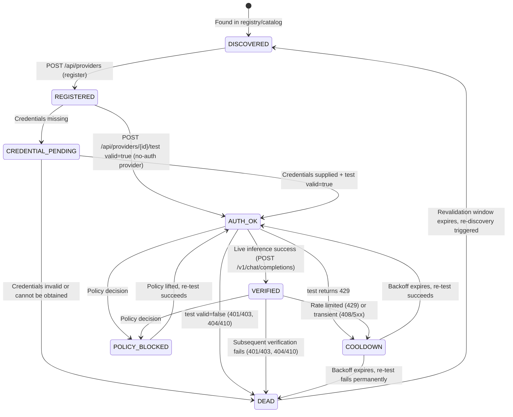

# Provider / Model Lifecycle — State Machine

## Overview

Every provider and model in OmniRoute transitions through a defined lifecycle.
States are explicit, observable, and driven by API responses. No entity may
skip to VERIFIED without live inference evidence.

---

## States

| State | Description |
|---|---|
| **DISCOVERED** | Entity found in registry or upstream catalog. Not yet registered with OmniRoute. |
| **REGISTERED** | Entity exists in OmniRoute (`/api/providers`). Credentials may or may not be configured. |
| **CREDENTIAL_PENDING** | Provider is registered but requires credentials that are not yet supplied (API key, OAuth token, or manual setup). |
| **AUTH_OK** | Credentials validated by `/api/providers/{id}/test` (`valid: true` at connection level). Inference not yet confirmed. |
| **VERIFIED** | Live inference succeeded. A concrete model produced a valid response via `/v1/chat/completions`. Eligible for routing pools. |
| **DEAD** | Provider or model is non-functional: auth failure, upstream gone, or policy-blocked. Excluded from routing. |
| **COOLDOWN** | Temporary exclusion due to rate limiting (429) or transient errors. Will be re-evaluated after a backoff window. |
| **POLICY_BLOCKED** | Provider or model is functional but excluded by policy decision (e.g., OpenRouter free-route policy, compliance). |

---

## State Diagram

---

## Transitions

### Forward (promotion)

| From | To | Trigger |
|---|---|---|
| DISCOVERED | REGISTERED | Provider registered via management API |
| REGISTERED | CREDENTIAL_PENDING | Provider exists but credentials are not configured |
| REGISTERED | AUTH_OK | `POST /api/providers/{id}/test` → `valid: true` (no-auth provider) |
| CREDENTIAL_PENDING | AUTH_OK | Credentials supplied and `POST /api/providers/{id}/test` → `valid: true` |
| AUTH_OK | VERIFIED | `POST /v1/chat/completions` → 200 with valid response body |

### Failure (demotion)

| From | To | Trigger |
|---|---|---|
| CREDENTIAL_PENDING | DEAD | Credentials rejected (401/403) or unobtainable |
| AUTH_OK | DEAD | `POST /api/providers/{id}/test` → `valid: false` with auth or unavailable diagnosis |
| AUTH_OK | COOLDOWN | `POST /api/providers/{id}/test` → 429 |
| VERIFIED | DEAD | Re-verification returns 401/403 or 404/410 |
| VERIFIED | COOLDOWN | Inference returns 429 or transient 408/5xx |
| Any | POLICY_BLOCKED | Explicit policy decision to exclude |

### Recovery

| From | To | Trigger |
|---|---|---|
| DEAD | DISCOVERED | Revalidation window expires; entity re-enters discovery pipeline |
| COOLDOWN | AUTH_OK | Backoff window expires and re-test succeeds |
| COOLDOWN | DEAD | Backoff window expires and re-test fails permanently |
| POLICY_BLOCKED | AUTH_OK | Policy restriction lifted and re-test succeeds |

---

## Error Classification

Errors from `POST /api/providers/{id}/test` and `POST /v1/chat/completions`
are classified as follows:

| HTTP Status | Class | State Transition | Notes |
|---|---|---|---|
| **401** | Auth failure | → DEAD | Credential revoked, expired, or invalid |
| **403** | Auth/Policy | → DEAD | Forbidden; may also indicate policy block |
| **404** | Unavailable | → DEAD | Model or endpoint no longer exists |
| **410** | Gone | → DEAD | Resource permanently removed |
| **429** | Quota/Rate limit | → COOLDOWN | Temporary; apply backoff |
| **408** | Timeout | → COOLDOWN | Transient; retry with backoff |
| **500–599** | Transient upstream | → COOLDOWN | Server error; retry with backoff |
| **200 + invalid body** | Malformed | → COOLDOWN (first), DEAD (repeated) | Response not parseable as valid completion |

---

## Revalidation Windows

| Current State | Window | Action on Expiry |
|---|---|---|
| **DEAD** | 24 hours | Re-enter discovery pipeline. Re-test from AUTH_OK if credentials still present. |
| **COOLDOWN** | Exponential backoff: 1 min → 5 min → 15 min → 1 hr → 4 hr (cap) | Re-test. If 3 consecutive failures at cap → transition to DEAD. |
| **POLICY_BLOCKED** | Manual review or policy update event | Re-test only after explicit policy change. |
| **VERIFIED** | 12 hours (periodic re-verification) | Run connection test + single inference. Demote on failure. |

---

## Promotion Rule

> **A concrete route enters VERIFIED only after successful live inference.**

Specifically:

1. The provider must be in AUTH_OK (credentials validated).
2. A `POST /v1/chat/completions` request using the concrete model ID must
   return HTTP 200 with a parseable completion response.
3. The request must use `max_tokens: 5` (or minimal) to reduce cost.
4. Registry metadata, provider claims, historical records, or connection-test
   results alone are **never** sufficient for VERIFIED status.

This rule is absolute. No exceptions.

---

## Implementation Notes

- State transitions are recorded with timestamps in the monetizer log.
- The state machine is enforced programmatically by the onboarding/repair
  pipeline (`IMPLEMENTATION_PLAN.md` Phase 3–4).
- OmniRoute's own internal state (`/api/providers`) is the system of record
  for REGISTERED and above. The monetizer tracks DISCOVERED and lifecycle
  metadata externally.
- State queries should always inspect live OmniRoute behavior first
  (see Source of Truth ordering in `IMPLEMENTATION_PLAN.md` §A).
